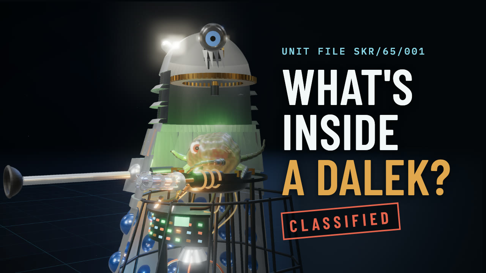
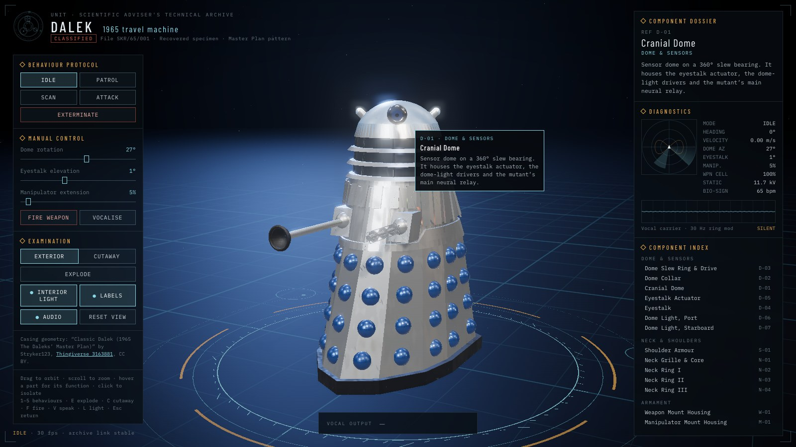
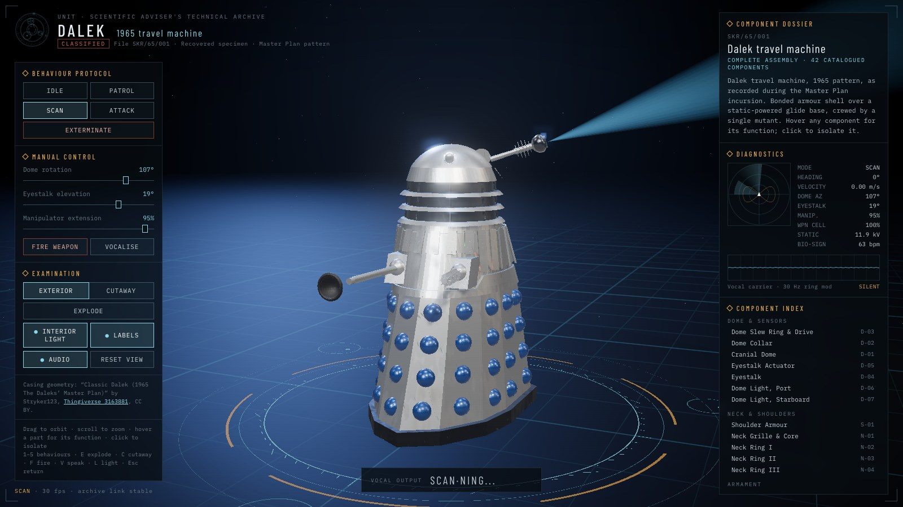
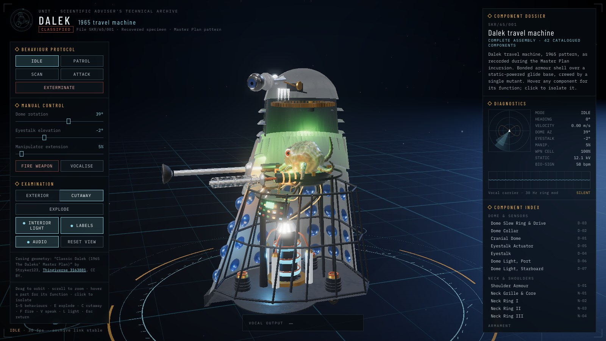
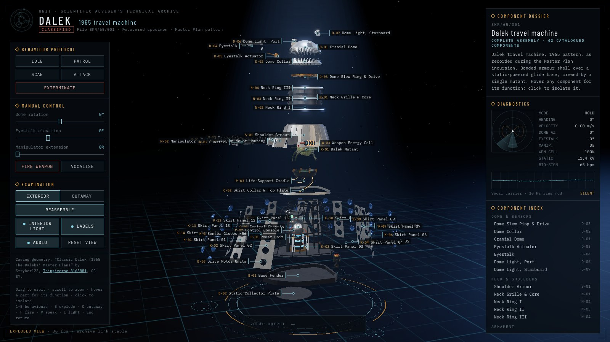
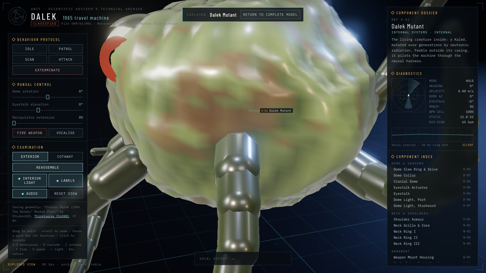
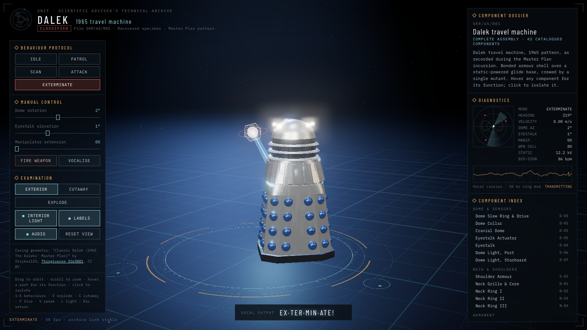

# Dalek 3D: the UNIT technical archive

An interactive 3D Dalek in a single HTML file. It's a 1965 *Daleks' Master Plan*-pattern travel machine, presented as a classified UNIT engineering archive. Orbit it and work its dome, eyestalk and arm. Run its Patrol, Scan, Attack and Exterminate protocols. Cut the casing away, explode it into labelled components, and isolate the Kaled mutant inside.

**▶ Open the archive:** https://greencat667.github.io/dalek-3d/

## The film

**[The Kembel Casing: What's Inside a 1965 Dalek?](https://youtu.be/qv3aiwmRwJw)** (2:38) is a short fan film shot entirely inside this archive. Records Officer Cadogan opens file SKR/65/001 on the night shift to brief new personnel. The idle protocol was supposed to be switched off.

## Screenshots

| | |
|---|---|
|  |  |
| **Exterior.** Hover any part for its function. | **Scan.** The eyestalk sweeps with a beam. |
|  |  |
| **Cutaway.** Drive motors, power unit, console, cradle and mutant. | **Exploded view.** 42 components, each labelled. |
|  |  |
| **Isolate.** Click any part to inspect it alone. | **Exterminate.** On archive film, a hit shows as a photographic negative. |

## What it does

- **Behaviours.** Idle (it watches you), Patrol (a gliding figure-eight), Scan, Attack (holographic target drones) and Exterminate.
- **Manual control.** Dome rotation, eyestalk elevation, manipulator extension, fire and vocalise.
- **Voice.** Sixteen ring-modulated phrases. The dome lights flash on the loudness of each word, and captions highlight words as they're spoken.
- **Examination.** Exterior or cutaway view, exploded view with floating labels, click-to-isolate, interior lighting, and a component index.
- **Diagnostics.** A radar, live telemetry and an oscilloscope on the vocal carrier.
- **Film mode.** Add `?film` to the URL for a frame-exact 30 fps clock, an on-screen cursor and a sound-cue log. A browser driver uses it to record footage frame by frame, which is how the film was shot.

Keys: `1`–`5` behaviours · `E` explode · `C` cutaway · `F` fire · `V` speak · `L` interior light · `Esc` return.

## How it's built

Everything is in `index.html`: Three.js r160 from a CDN, with no build step. Open it locally or serve the folder.

- **Casing:** the outer casing comes from Stryker123's 1965 Dalek model (see credits). Its 127,174 triangles were split into the archive's named components: 14 skirt panels, 56 individual globes, the shoulders, gun boxes, gunstick, sucker arm, neck, rings, dome, eyestalk and lights. They are converted to metres and embedded as gzipped int16 (`tools/stl/`). Flat sheets get flat or unified normals, and curved parts get creased normals, so the long fan triangles don't streak.
- **Internals:** built procedurally in code, including the chassis, drive motors, static power unit, control console, life-support cradle and the Kaled mutant.
- **Voice:** Kokoro speech, staccato syllable gating, a 30 Hz ring modulator and clipping. Whisper times each word and checks it reads back correctly (`tools/voice/`).
- **Weathering:** an object-space noise shader. Reflections come from a room environment map.

## Credits

- Casing geometry: [“CLASSIC DALEK FROM (1965 The Daleks Master Plan)”](https://www.thingiverse.com/thing:3163881) by Stryker123, licensed CC BY.
- The Daleks were created by Terry Nation and designed by Raymond Cusick.
- An unofficial, non-commercial fan project. Doctor Who and the Daleks © BBC. Not affiliated with or endorsed by the BBC.

## Licence

The code in this repository is MIT licensed (see `LICENSE`). The embedded casing geometry remains under its original CC BY licence; credit Stryker123 if you reuse it. Doctor Who and the Daleks are not covered by either licence.
